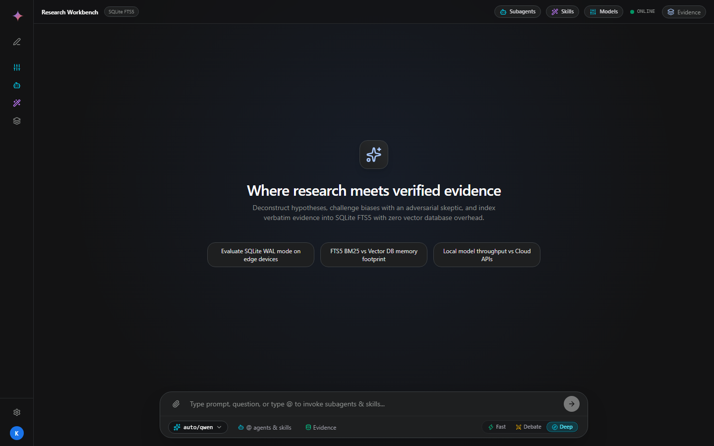
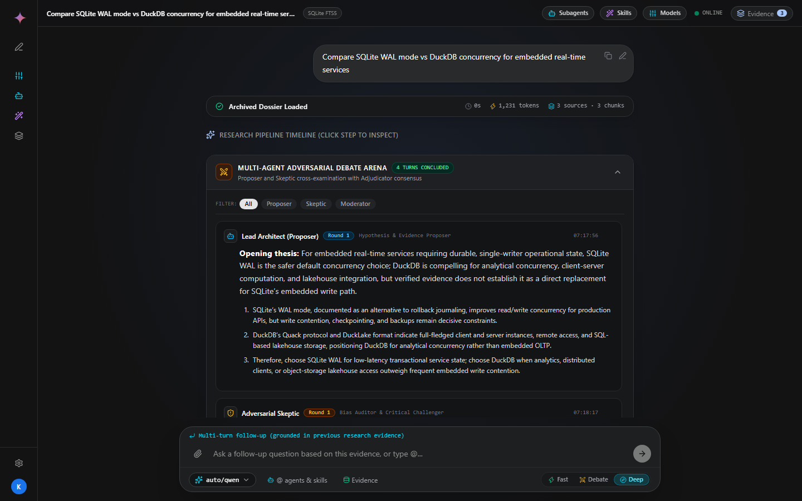

# BYOK Research Harness & Autonomous Agent Workbench

A private, local-first **Bring Your Own Key (BYOK)** autonomous research workbench, multi-agent adversarial court debate arena, and evidence citation engine.

Powered by **FastAPI**, **SQLite FTS5 (WAL mode)**, **AES-256-GCM Key Vault**, **React 19**, and **Tailwind CSS v4**.

---



---

## Key Highlights

- **Zero-Telemetry & 100% Local-First**: All API keys, search logs, evidence chunks, and research histories live in a local SQLite database with `PRAGMA journal_mode=WAL`.
- **Encrypted BYOK Vault**: Store and manage credentials for local models (Ollama, LM Studio, vLLM, OmniRoute) and cloud endpoints (OpenAI, Gemini, Anthropic) encrypted using AES-256-GCM with PBKDF2 master key derivation.
- **Configurable Research Execution Modes**:
  - **Fast Direct (⚡)**: Direct single-turn synthesis with system prompt guidance (< 2 seconds, bypassing web search).
  - **Court Debate (⚔️)**: Dedicated 4-turn adversarial cross-examination between Proposer, Skeptic, and Adjudicator.
  - **Deep Research (🔍)**: Comprehensive multi-agent pipeline featuring hypothesis decomposition, parallel web discovery, FTS5 extraction, debate, and citation synthesis.
- **Multi-Agent Adversarial Debate Arena**: Built-in cross-examination protocol where a **Lead Architect (Proposer)** and an **Adversarial Challenger (Skeptic)** contest boundary conditions before an **Impartial Adjudicator** issues a consensus ruling.
- **Local Document Ingestion & SQLite FTS5 BM25 Retrieval**: Upload reference documents (`.txt`, `.md`, `.py`, `.json`, `.csv`, `.pdf`); text is chunked and indexed into SQLite FTS5 virtual tables with synchronized triggers.
- **Gemini-Style URL Routing (`/app/<chat_id>`)**: Clean session paths with automatic URL updating upon run dispatch, seamless browser back/forward navigation (`popstate`), and instant session rehydration on page reload.
- **Multi-Format Export Engine**: Generate publication-grade Markdown with YAML frontmatter, self-contained Print-to-PDF HTML reports, and structured machine-readable JSON research dossiers.

---

## Multi-Agent Debate Arena & Synthesis



The adversarial debate arena subjects research claims to rigorous multi-agent scrutiny before final synthesis:

1. **Round 1 (Opening Thesis)**: Lead Architect articulates primary assertions grounded in retrieved evidence.
2. **Round 1 (Adversarial Critique)**: Skeptic audits assertions for confirmation bias, hidden trade-offs, and boundary failures.
3. **Round 2 (Rebuttal & Refinement)**: Lead Architect refines parameters, conceding edge cases and establishing verified limits.
4. **Round 2 (Consensus Ruling)**: Debate Adjudicator synthesizes the balanced consensus verdict.
5. **Editor Synthesis**: Principal analyst synthesizes the final report with Markdown tables, bold emphasis, and citation badges linked to indexed evidence.

---

## Architecture

```text
                               +----------------------------------------------------+
                               |                   Browser Client                   |
                               |  React 19 + TypeScript + Tailwind v4 + Lucide UI   |
                               +-------------------------+--------------------------+
                                                         |
                                 REST (JSON) / SSE Stream | Routes: /app, /app/:chat_id
                                                         v
+-----------------------------------------------------------------------------------+
|                                  FastAPI Backend                                  |
|                                                                                   |
|  +--------------------+     +-----------------------+     +--------------------+  |
|  |   Router & Auth    |     |  Execution Dispatcher |     |   Export Engine    |  |
|  | /api/vault/*       |     |  - Fast Direct        |     |  - Markdown+YAML   |  |
|  | /api/subagents     |     |  - Court Debate       |     |  - Standalone HTML |  |
|  | /api/skills        |     |  - Deep Web Research  |     |  - JSON Dossier    |  |
|  +---------+----------+     +-----------+-----------+     +---------+----------+  |
|            |                            |                           |             |
|            v                            v                           v             |
|  +--------------------+     +-----------------------+     +--------------------+  |
|  | AES-256-GCM Vault  |     |  Multi-Agent Pipeline |     |   Web & Search     |  |
|  | PBKDF2 Derivation  |     |  - Planner SubAgent   |     |  - DuckDuckGo /    |  |
|  | Encrypted API Keys |     |  - Skeptic Challenger |     |    SearXNG Search  |  |
|  | SQLite Storage     |     |  - Proposer Defense   |     |  - Trafilatura &   |  |
|  +--------------------+     |  - Adjudicator Arbiter|     |    BeautifulSoup   |  |
|                             |  - Chief Synthesizer  |     +--------------------+  |
|                             +-----------+-----------+                             |
+-----------------------------------------|-----------------------------------------+
                                          |
                                          v
+-----------------------------------------------------------------------------------+
|                        SQLite Database (PRAGMA WAL Mode)                          |
|                                                                                   |
|  [ research_runs ]          [ run_events (SSE Log) ]     [ vault_keys ]           |
|  [ sources (URL Cache) ]    [ evidence_chunks ]          [ evidence_chunks_fts ]  |
|  [ custom_subagents ]       [ custom_skills ]            [ claim_citations ]      |
+-----------------------------------------------------------------------------------+
```

---

## Research Execution Modes

| Mode | Pipeline Flow | Latency | Web Queries | Ideal For |
|:---|:---|:---|:---|:---|
| **Fast Direct (⚡)** | Ingest Files -> Direct LLM Stream | < 2s | 0 | Quick answers, code generation, direct reasoning |
| **Court Debate (⚔️)** | Ingest Files -> 4-Turn Adversarial Cross-Examination -> Synthesis | 10–25s | 0 | Thesis evaluation, architectural trade-offs, sanity checks |
| **Deep Research (🔍)** | Planner -> Web Search -> Scrape & Index -> Court Debate -> Synthesis | 30–75s | 2–3 queries | Multi-source investigation, fact discovery, literature surveys |

---

## URL Path Routing (`/app/<chat_id>`)

Sessions use clean Gemini-style paths:

- **`/app`** or **`/`**: Blank start workbench with suggestion pills and mode selector.
- **`/app/:chat_id`**: Loads specific research runs (e.g., `/app/1730bfbb4899`).
  - Automatically pushes to browser history upon run creation.
  - Page reloads rehydrate the full conversation, debate turns, and evidence ledger.
  - Browser Back and Forward buttons navigate across visited research sessions.
  - Nonexistent chat IDs gracefully redirect to `/app` with an informational notice.

---

## Project Structure

```text
.
├── app/
│   ├── config.py             # Environment configuration and paths
│   ├── db.py                 # SQLite WAL initialization, FTS5 virtual tables, BM25 retrieval
│   ├── main.py               # FastAPI application, SSE streaming dispatch, REST endpoints
│   ├── export/
│   │   └── exporter.py       # Markdown, print-ready HTML, and JSON dossier exporter
│   ├── fetch/
│   │   └── web_fetcher.py    # Trafilatura/BS4 scraper, semantic chunker, local file ingest
│   ├── providers/
│   │   ├── base.py           # Abstract LLM provider interface & ModelMessage schema
│   │   └── openai_compat.py  # OpenAI-compatible streaming client
│   ├── search/
│   │   └── engine.py         # Web search engine with DuckDuckGo fallback
│   └── vault.py              # AES-256-GCM encryption & secure key management
├── frontend/
│   ├── src/
│   │   ├── App.tsx           # Primary application workbench, state, layout
│   │   ├── types.ts          # TypeScript domain interfaces and events
│   │   ├── components/
│   │   │   ├── DebateChatLog.tsx     # Adversarial court debate visualizer
│   │   │   ├── EvidenceDrawer.tsx    # FTS5 evidence ledger with domain filter chips
│   │   │   ├── InputBar.tsx          # Input controls, prompt history, mode pills
│   │   │   ├── MarkdownRenderer.tsx  # GFM parser, code copy, and citation badges
│   │   │   ├── ReportExportBar.tsx   # Markdown, HTML, JSON, and Print-PDF export bar
│   │   │   ├── Sidebar.tsx           # Gemini-inspired collapsible navigation rail
│   │   │   └── TelemetryHUD.tsx      # Real-time token rate, TTFT, and elapsed counters
│   │   └── hooks/
│   │       └── useResearchStream.ts  # SSE connection lifecycle, queue, URL sync
├── tests/
│   ├── test_api.py           # End-to-end FastAPI endpoint and SSE stream tests
│   ├── test_db.py            # SQLite schema, FTS5 triggers, and unique constraints
│   ├── test_features.py      # BM25 search, file ingestion, debate exports unit tests
│   ├── test_provider.py      # LLM provider streaming verification
│   └── test_vault.py         # Cryptographic vault round-trip verification
├── docker-compose.yml        # Multi-container deployment configuration
└── Dockerfile                # Production container build
```

---

## Getting Started

### Prerequisites

- **Python 3.11+**
- **Node.js 18+** and **npm**

### 1. Installation

Clone the repository and install backend dependencies:

```bash
git clone https://github.com/krittaphato3/byok-research-harness.git
cd byok-research-harness

# Install Python requirements
pip install -r requirements.txt
```

Install frontend dependencies:

```bash
cd frontend
npm install
npm run build
cd ..
```

### 2. Running Locally

Start the FastAPI application:

```bash
python -m uvicorn app.main:create_app --factory --host 127.0.0.1 --port 8000
```

Open your browser and navigate to:

```text
http://127.0.0.1:8000/app
```

For frontend active development with Vite HMR:

```bash
cd frontend
npm run dev
# Serves on http://localhost:3000 with proxy to FastAPI on port 8000
```

### 3. Docker Deployment

Run the self-contained container stack using Docker Compose:

```bash
docker-compose up --build -d
```

The application will be accessible at `http://localhost:8000`.

---

## Verification & Testing

Run the automated test suites:

```bash
# 1. Database schema, triggers, and WAL mode verification
PYTHONPATH=. python tests/test_db.py

# 2. Cryptographic vault encryption verification
PYTHONPATH=. python tests/test_vault.py

# 3. FTS5 BM25 search, file ingestion, and export validation
PYTHONPATH=. python tests/test_features.py

# 4. End-to-end API and SSE stream validation
PYTHONPATH=. python tests/test_api.py

# 5. Frontend TypeScript verification and production bundling
npm --prefix frontend run build
```

---

## License

This project is licensed under the [MIT License](LICENSE).
